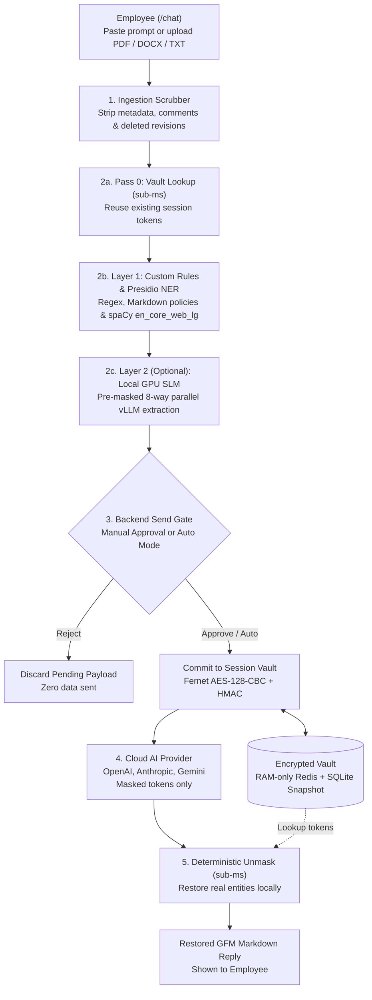
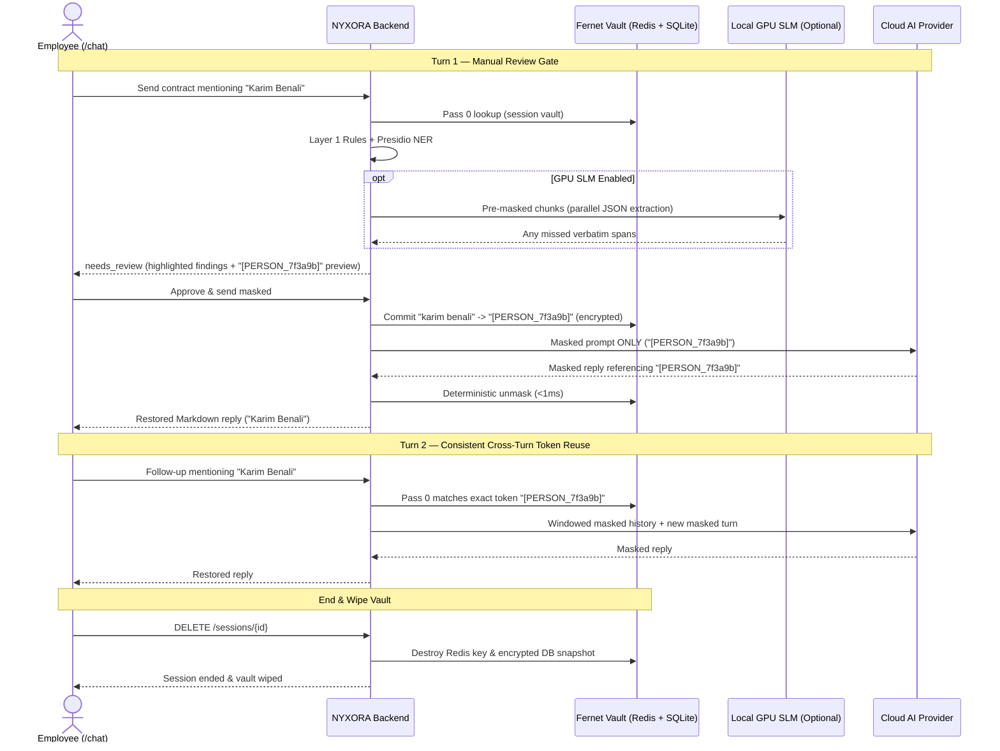

# NYXORA — Contract Privacy Gateway

> **Think freely. Share nothing sensitive.**  
> Strong AI on your most sensitive contracts, without raw confidential data ever leaving your control.  
> Built for **MAKERS² 2026** (Track 02: AI for Work & Business).

NYXORA is a self-hosted privacy gateway that sits between company employees and external frontier AI models (OpenAI, Anthropic, Google Gemini, or OpenAI-compatible endpoints). Sensitive names, companies, tax IDs, phone numbers, emails, bank details, and custom codenames are detected and replaced locally with random tokens (`[PERSON_7f3a9b]`, `[COMPANY_3c91a2]`) before anything leaves your server—and restored deterministically in `<1ms` when the AI replies.

---

## How It Works

### Privacy Gateway Architecture



### Multi-Turn Send Gate & Vault Sequence



---

## Key Capabilities

- **ChatGPT / Claude-Style Employee Workspace (`/chat`)**
  - Clean collapsible session sidebar with inline chat naming/renaming, relative timestamps, and destructive delete + vault wipe confirmation.
  - Upload `.pdf`, `.docx`, or `.txt` files with automatic stripping of document metadata, comments, and deleted tracked changes.
  - Inline **Send Gate** review card comparing highlighted original text side-by-side with the exact masked wire payload before approval.
  - One-click **Restored / Masked view** toggle, **GFM Markdown** assistant responses (tables, lists, copyable code blocks), and a live 3-tab **Privacy Inspector** (**Vault**, **Wire**, **Security**).
- **Owner Governance Console (`/rules` & `/metrics`)**
  - Configure OpenAI, Anthropic, Gemini, OpenAI-compatible, or Local Mock providers with Fernet-encrypted API keys at rest and live model discovery (including thinking-effort controls).
  - Manage workspace defaults, custom keyword/regex rules, Markdown policy import (`docs/sample-rules.md`), and optional remote GPU SLM connection testing.
  - Provision or deactivate user accounts (`owner` / `user` RBAC; public sign-up disabled) and inspect the metadata-only **Audit Log**.
  - Run live **Evaluation & Ablation Benchmarks** across 60 synthetic + 14 realistic labeled contracts (per-entity recall/precision, leak-free rate, layer-by-layer ablation, and 100% unmask round-trip verification).
- **Security & Privacy Architecture**
  - **Backend-enforced Send Gate:** External providers only ever receive approved masked payloads.
  - **Fernet-encrypted vaults:** Per-session `AES-128-CBC + HMAC-SHA256` vaults cached in persistence-disabled Redis (`--save "" --appendonly no`) with encrypted DB snapshots and instant one-click wipe (`DELETE /sessions/{id}`).
  - **Zero plaintext secrets at rest:** Argon2id password hashes, SHA-256 session tokens, Fernet-encrypted provider keys, and metadata-only audit logs.
  - **Algerian Law 18-07 & 25-11 context:** NYXORA is engineered to reduce personal-data exposure and keep a human in control. It is a technical privacy gateway and does not constitute legal certification or legal counsel.

---

## Tech Stack

| Layer | Technologies |
| :--- | :--- |
| **Frontend** | Next.js 16 (App Router, Turbopack), React 19, TypeScript, Tailwind CSS v4, shadcn/ui (`@base-ui/react`), Lucide React, `react-markdown` + `remark-gfm` |
| **Backend & API** | Python 3.12, FastAPI, Uvicorn, Pydantic Settings v2, `httpx` |
| **Data & Vault Cache** | SQLAlchemy 2.0 + SQLite (WAL mode), Redis 7 (`--save "" --appendonly no` RAM-only cache) |
| **Security & Crypto** | `cryptography` (Fernet: AES-128-CBC + HMAC-SHA256), `pwdlib[argon2]` (Argon2id), SHA-256 HttpOnly cookie sessions, `owner` / `user` RBAC |
| **Detection & Scrubbing** | Pass 0 Vault Lookup, Custom Keyword/Regex Rules + Markdown policy import, Microsoft Presidio + spaCy (`en_core_web_lg`), `pypdf` + DOCX XML scrubber |
| **Local GPU SLM (Optional)** | vLLM (`vllm/vllm-openai`) serving `Qwen/Qwen2.5-7B-Instruct-AWQ` on NVIDIA/RunPod with prefix caching & 8-way parallel chunking |
| **Frontier Providers** | OpenAI, Anthropic, Google Gemini, OpenAI-compatible endpoints, and Local Mock provider behind one unified adapter |
| **Infra & Testing** | Docker & Docker Compose, `uv`, `pytest` (`TestClient`), ESLint, TypeScript (`tsc --noEmit`) |

---

## Quickstart (Local)

### 1. Run with Docker Compose

From the repository root:

```bash
docker compose up --build
```

For development with live hot reload on both `frontend/` (`next dev`) and `backend/app/` (`uvicorn --reload`):

```bash
docker compose -f compose.yaml -f compose.dev.yaml up --build
```

Open the app at **`http://127.0.0.1:3000`** and verify the API health check:

```bash
curl -fsS http://127.0.0.1:8000/health
```

Stop the stack with:

```bash
docker compose down
```

### 2. Local Demo Accounts (`SEED_DEMO_USERS=true`)

When running locally via `compose.yaml`, two demo accounts are seeded automatically on an empty database:

| Role | Email | Password | Access |
| :--- | :--- | :--- | :--- |
| **Owner** | `owner@acme.local` | `demo-owner-pass` | `/chat`, `/rules`, `/metrics` |
| **User** | `user@acme.local` | `demo-user-pass` | `/chat` only |

> **Production note:** Set `APP_ENV=production`, `AUTH_COOKIE_SECURE=true`, `SEED_DEMO_USERS=false`, and generate a real 32-byte Fernet `VAULT_ENCRYPTION_KEY` before deploying.

---

## Optional Local GPU SLM Server

To enable the optional Layer 2 extraction SLM (e.g., `Qwen/Qwen2.5-7B-Instruct-AWQ` over vLLM), see [gpu/README.md](gpu/README.md) and [scripts/setup-gpu-server.sh](scripts/setup-gpu-server.sh), then enter the endpoint in **Owner Settings → Defaults & GPU** and click **Test GPU connection**.

---

## Verification & Tests

- **Backend tests:**
  ```bash
  cd backend && pytest
  ```
- **Frontend lint & typecheck:**
  ```bash
  cd frontend && npm run lint && npx tsc --noEmit
  ```

---

## Repository Structure

```text
.
├── frontend/          # Next.js 16 (App Router) + Tailwind CSS v4 + shadcn/ui (Base UI)
├── backend/           # FastAPI + SQLAlchemy + Presidio/spaCy + Fernet vault + evaluation runner
├── gpu/               # Optional remote vLLM GPU server Docker Compose setup
├── scripts/           # GPU server provisioning script
├── docs/              # Roadmap, architecture invariants, and sample Markdown rules
├── compose.yaml       # Full stack (frontend, backend, persistence-disabled Redis, SQLite volume)
└── compose.dev.yaml   # Hot-reload development override
```

For full architecture decisions, privacy invariants, and roadmap status, see [docs/ROADMAP.md](docs/ROADMAP.md).
